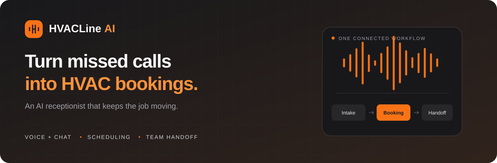

  

  <strong>AI receptionist and appointment booking for HVAC businesses.</strong> 
  Answer customer questions, capture service requests, and keep bookings moving.

  <a href="https://hvacline.online">Visit HVACLine</a> ·
  <a href="https://www.hvacline.online/dashboard">Dashboard</a> ·
  <a href="https://www.hvacline.online/ai-lead-recovery">Try Yourself</a> ·
  <a href="https://www.hvacline.online/multilingual-ai-voice">Try Multilingual Demo</a> ·
  <a href="LICENSE">Proprietary license</a>

   
  
  

## Features

- **Voice & chat:** Help customers through browser conversations, telephone, and inbound WhatsApp voice.
- **Multilingual AI Voice · Preview:** Explore a fictional [multilingual HVAC conversation](https://www.hvacline.online/multilingual-ai-voice), switch languages during intake, and keep customer details and booking confirmations together.
- **Appointment booking:** Match requests to service areas, business hours, and technician availability, with customer confirmation.
- **Service intake:** Collect contact details, service addresses, equipment issues, and preferred appointment times.
- **Operations dashboard:** Manage requests, appointments, calls, callbacks, and team handoffs in one workspace.
- **AI Lead Recovery · Preview:** Explore missed-call follow-up and unfinished bookings in an interactive dashboard demo.
- **Customer accounts:** Appointment history, rescheduling, authenticator MFA, and optional customer-controlled memory.
- **iOS & Android app · Preview:** An Expo and React Native [customer app](apps/mobile) for voice/chat booking, authenticator MFA, appointments, and rescheduling.
- **Business knowledge:** Answer from approved FAQs and route hazardous or unsupported requests to staff.
- **Calendar & reminders:** Optional Google Calendar sync and booking emails/reminders.
- **Voice AI websites · Preview:** Customize three templates, save drafts, publish versions, and restore previous content.
- **GoHighLevel · Preview:** Sync confirmed leads, route calendar bookings, and add contact summaries.
- **Maintenance billing · Sandbox:** Stripe packages, purchased labor hours, and billing history.

## Multilingual AI Voice · Preview

Language targets: **English (en), Spanish (es), French (fr), Arabic (ar), Hindi (hi), and Mandarin Chinese (zh)**. **Urdu (ur)** is conditional on verified support across the configured speech recognition, language model, voice and agent.

English remains the existing default. Additional browser and mobile languages require configured ElevenLabs support and channel-specific verification. Additional inbound telephone and lead-recovery languages remain unsupported in this revision. The public demo uses clearly labeled fictional text, without real calls or generated speech.

Live language quality and runtime acceptance are **UNVERIFIED**. See [language availability and setup](docs/multilingual-voice.md).

## License

**Proprietary. All rights reserved.** Any use, including free or noncommercial use, requires prior written permission. See [LICENSE](LICENSE) for full terms and exceptions.
