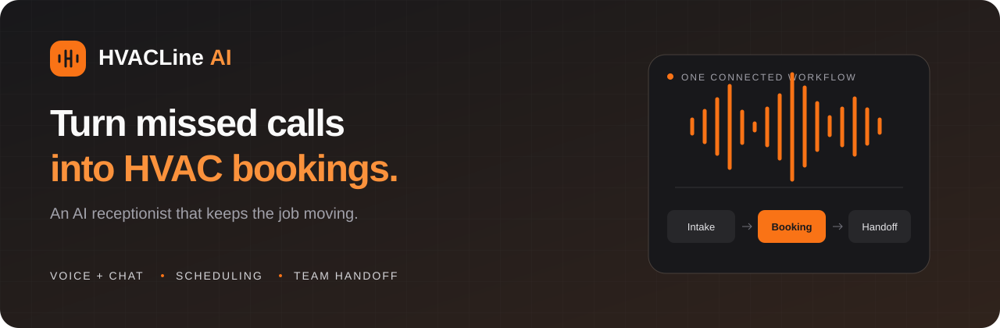

  

  <strong>AI receptionist and appointment booking for HVAC businesses.</strong> 
  Capture service requests, answer customer questions, and keep your team organized.

  <a href="https://hvacline.online">Visit HVACLine</a> ·
  <a href="LICENSE">Proprietary license</a>

## Features

- **Voice & chat:** Help customers through browser conversations, telephone, and inbound WhatsApp voice.
- **Appointment booking:** Match requests to service areas, business hours, and technician availability, with customer confirmation.
- **Service intake:** Collect contact details, service addresses, equipment issues, and preferred appointment times.
- **Operations dashboard:** Manage requests, appointments, calls, callbacks, and team handoffs in one workspace.
- **Customer accounts:** Appointment history, rescheduling, authenticator MFA, and optional customer-controlled memory.
- **Business knowledge:** Answer from approved FAQs and route hazardous or unsupported requests to staff.
- **Calendar & reminders:** Optional Google Calendar sync and booking emails/reminders.
- **Voice AI websites · Preview:** Customize three templates, save drafts, publish versions, and restore previous content.
- **GoHighLevel · Preview:** Sync confirmed leads to contacts and opportunities with booking-stage updates.
- **Maintenance billing · Sandbox:** Stripe packages, purchased labor hours, and billing history.

## License

**Proprietary. All rights reserved.** Any use, including free or noncommercial use, requires prior written permission. See [LICENSE](LICENSE) for full terms and exceptions.
